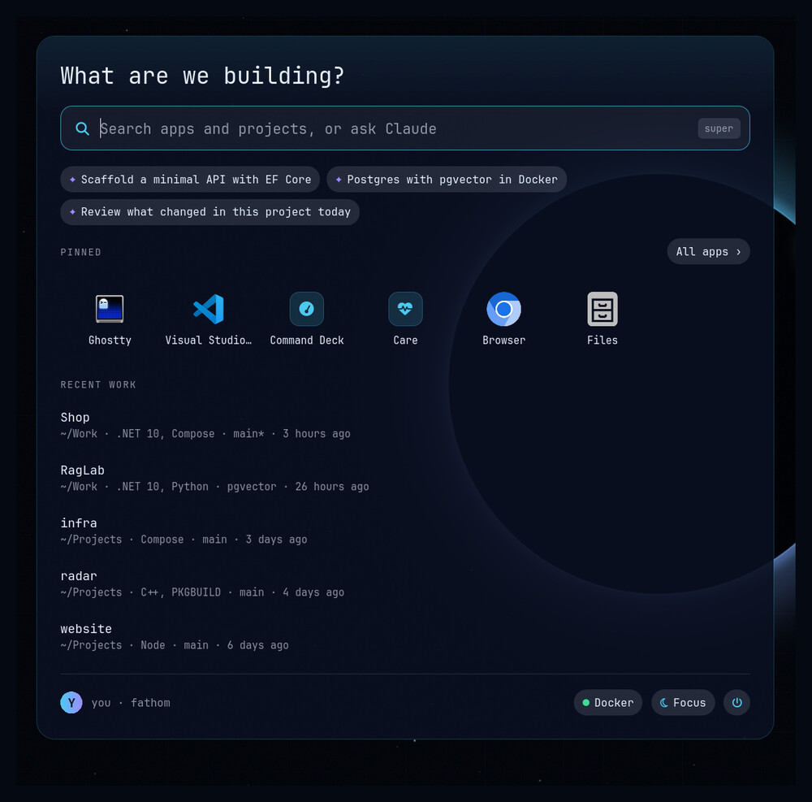
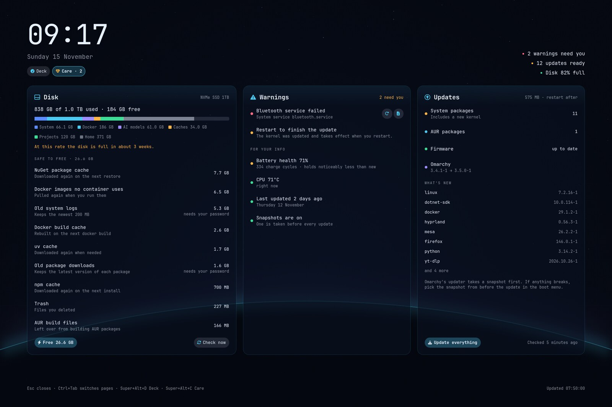
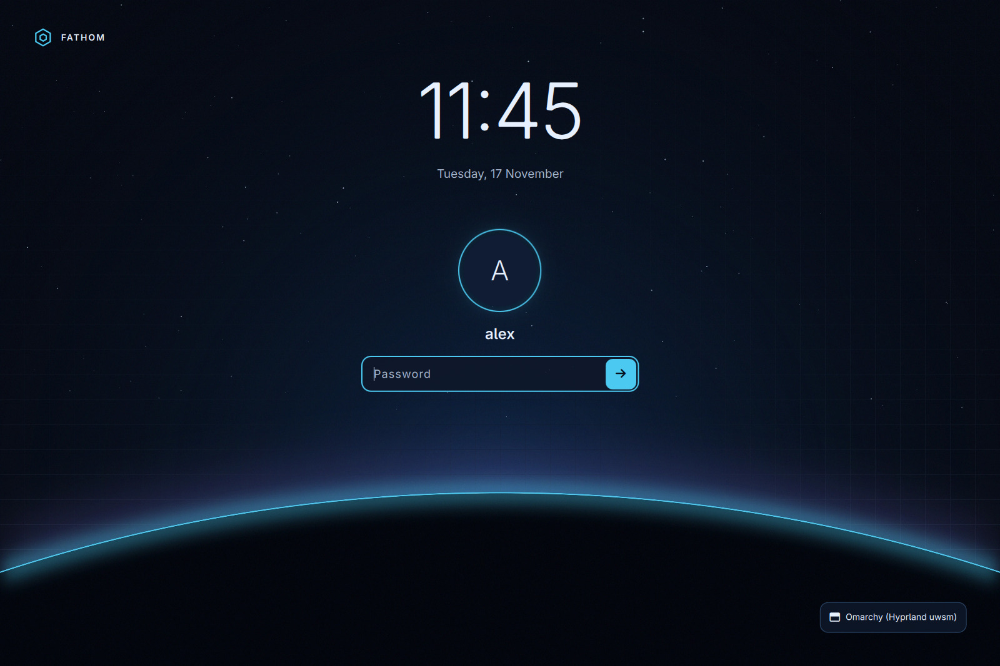

# Fathom

A futuristic, Windows-inspired desktop layer for [Omarchy](https://omarchy.org),
built for Docker, .NET and AI work. Deep-space navy, cyan and violet, with
windows framed in a cyan-to-violet gradient.


## Install

```bash
git clone <this repo> ~/Work/fathom
cd ~/Work/fathom
./install.sh            # the desktop theme, the mini-player and the Command Deck
./install.sh --signin   # adds the sign-in screen (asks for your password)
```

| Option | What it does |
|---|---|
| `--skin` | The desktop theme |
| `--player` | The mini-player, its keys and its bar widget |
| `--deck` | The Start menu, the Command Deck and its Care page, their keys, and Care's check every 3 hours |
| `--mail` | New-mail notifications and their background service (then add your account; see [Mail](#mail)) |
| `--sentinel` | Sentinel, its key and its watcher service, plus its daily file check and firewall buttons, which need your password |
| `--opensnitch` | With `--sentinel`: also install OpenSnitch, which asks the first time each app connects somewhere new |
| `--signin` | The sign-in screen. Needs your password |
| `--all` | Every part (OpenSnitch only with `--opensnitch`) |
| `--link` | Link the theme, the commands and their Hyprland files to this repo instead of copying, for working on them |
| `--no-apply` | Install the desktop theme without switching to it |

With no part named, it installs the parts that need no password: `--skin`,
`--player`, `--deck` and `--mail`.

`./uninstall.sh` switches back to the theme that was on before, removes
what the installer added (OpenSnitch only if Fathom installed it), and puts
Omarchy's sign-in screen back. It leaves
alone any `fathom` theme it did not make.

## What's here

```
theme/          The Omarchy desktop theme: colours, wallpapers, icons,
                preview, boot unlock logo
signin/fathom/  The sign-in screen, an SDDM theme in QML
signin/install-root.sh
                The only part that runs as root: copies the sign-in theme
                and selects it
player/bin/fathom-player
                The mini-player command (plays and controls mpv)
player/hypr/    Its window rules and keys
player/plugin/fathom.player/
                Its bar widget
deck/bin/fathom-deck
                The Command Deck's command: reads the machine as JSON and
                starts, stops and restarts containers
deck/hypr/      Its key and blur
deck/plugin/fathom.deck/
                The deck itself, an Omarchy shell panel: the Deck, Care and
                Sentinel pages and the Start menu
start/bin/fathom-start
                The Start menu's command: recent projects, pins, asking
                Claude Code, Focus mode and power
care/bin/fathom-care
                Care's command: measures the disk, finds failed services
                and updates, and cleans up
care/systemd/   The timer that runs Care's check every 3 hours
mail/bin/fathom-mail
                Mail's command (Python, standard library only)
mail/fathom_mail/
                Its package: core.py (keyring, HTTP, notifications) and one
                module per mail service (outlook.py)
mail/systemd/   The service that watches for new mail
sentinel/bin/fathom-sentinel
                Sentinel's command and watcher (Python, standard library only)
sentinel/fathom_sentinel/
                detect.py: turns journal lines, neighbours and file checks
                into events
sentinel/root/  The root parts: admin (the firewall buttons, run through
                pkexec) and check-files (the daily file check)
sentinel/systemd/
                The watcher (a user service) and the file check's service
                and timer (system)
sentinel/install-root.sh
                Installs and removes the root parts
art/            make-art.py, which draws the wallpapers, preview and logo
tests/          node --test tests/ && python3 -m unittest discover -s tests
install.sh      Installer
uninstall.sh    Undo the installer
```

## Mini-player

Copy a YouTube (or any [yt-dlp](https://github.com/yt-dlp/yt-dlp)-supported)
link and press **Super+Alt+Y**. It plays in a 640×360 window pinned to the
bottom-right corner, above everything and on every workspace, without taking
focus from what you're doing. Press Super+Alt+Y with another link copied to
switch to it. **Super+Ctrl+Y** closes it.

While it plays, the bar shows the title. Click it to pause, scroll to skip,
middle-click to mute and right-click to close. Your keyboard's media keys work
too (through `mpv-mpris`).

From a terminal or script:

```bash
fathom-player play https://www.youtube.com/watch?v=...
fathom-player toggle | back 10 | forward 10 | mute | stop | status
```

Video is capped at 720p to spare the battery; set `FATHOM_PLAYER_MAX_HEIGHT`
to change that. It needs `mpv`, `yt-dlp`, `socat`, `jq` and `wl-clipboard`,
all on Omarchy already.

Installing adds `~/.local/bin/fathom-player`, `~/.config/hypr/fathom-player.lua`,
three marked lines at the end of `~/.config/hypr/hyprland.lua` (after a
backup), and the `fathom.player` bar widget.

## Start menu



**Tap Super** on its own for Start, as on Windows. Super with any other key
works as before. Tap Super again or press Esc to close it.

- **Search or ask.** Type to find apps, recent projects and actions (the
  deck, Care, Focus mode, lock, sleep, restart and so on): ↑ ↓ and Enter, or
  click. Initials work too: *vsc* finds Visual Studio Code. The last rows
  always offer to **ask Claude Code** what you typed, in a terminal, either in
  your home folder or in your most recent project. Nothing is sent anywhere
  until you choose that; the suggestions under the search box ask the same
  way.
- **Pinned:** your terminal, editor, the Command Deck, Care, browser and
  Files to start with. Right-click any app (here or under **All apps**) to pin
  or unpin it.
- **Recent work:** the git projects in `~/Work`, `~/Projects` and similar
  folders you touched last, with what they're built with, the branch (`*`
  for uncommitted changes) and when. Click one to open it in your editor, or
  hover for a terminal there, Claude Code there, or Files.
- **Along the bottom:** whether Docker is running (click for the deck),
  **Focus** (Omarchy's do-not-disturb), and power: lock, sleep, sign out,
  restart, shut down. The last three ask first.

Pins and suggestions are kept in `~/.config/fathom/start.json`.

```bash
fathom-start                    # open or close it
fathom-start menu | jq .        # what it shows, as JSON
fathom-start pin obsidian       # pin an app by its desktop id
```

## Command Deck


Press **Super+Alt+D** for a glass overlay showing your dev machine at a glance.
Press it again, or Esc, or click outside the cards, to close it.

- **System:** CPU, GPU, memory and each disk. A disk over 85% full turns amber,
  over 95% red. It also shows how much space Docker's images, build cache and
  volumes take, since that's usually where a disk goes.
- **Containers:** every Docker container, grouped by Compose project, with its
  ports, CPU and memory. Red means unhealthy or crashed. Hover a row to start,
  stop or restart it, or to follow its logs in a terminal. The lazydocker
  button opens lazydocker.
- **.NET:** the installed SDK and the .NET apps running now (`dotnet run`,
  `dotnet watch`, AppHosts and other apps), with CPU and memory. Language
  servers and build nodes are counted in one line rather than listed.
- **AI:** the coding agents running (Claude Code, Codex, Gemini CLI, opencode,
  Aider and others), which project each is in, and whether it's working or
  idle. If Ollama is running, its loaded models and their VRAM.

Above the cards, a summary line puts whatever needs attention first.

The deck reads the machine only while it's open, every few seconds, and only
locally; the one network call is to Ollama on `127.0.0.1`. From a terminal:

```bash
fathom-deck status | jq .                # what the deck shows, as JSON
fathom-deck container restart <name>     # also start, stop
fathom-deck logs <name>
```

Installing adds `~/.local/bin/fathom-deck`, `~/.config/hypr/fathom-deck.lua`
(loaded from the same marked block in `hyprland.lua` as the mini-player) and
the `fathom.deck` shell plugin.

## Care



Care is the deck's second page: **Super+Alt+C**, or Ctrl+Tab while the deck
is open. It looks after the machine so you don't have to.

- **Disk:** what fills it (system, Docker, AI models, caches, projects, the
  rest of your home folder), how long until it's full at the current rate
  (once it has a few days of history), and what's **safe to free**: the trash,
  Docker's build cache and images no container uses, the NuGet, npm, uv and
  pip caches, AUR build files, old package downloads and old system logs. Each
  says what happens if you free it, and Care asks before deleting anything.
  Old package downloads and system logs need your password, so the deck
  closes for those and a notification says how much was freed.
- **Warnings:** failed services (yours and the system's), with buttons to
  restart one or read its log, a disk over 85% full, and a kernel update
  waiting for a restart. Below them: battery health, CPU temperature, when you
  last updated and whether snapshots are on.
- **Updates:** system packages (flagging a new kernel), AUR packages, firmware
  and Omarchy itself, with the download size. **Update everything** runs
  Omarchy's own updater in a terminal, which checks free space, takes a
  snapshot, updates, and verifies the system still boots.

A systemd user timer runs Care's check every 3 hours, and you get a
notification when something new needs you: a service fails or the disk passes
85% or 95%. The check asks the package mirrors, the AUR and fwupd what's new,
as Omarchy's own update check does; nothing else leaves the machine. To turn
the timer off: `systemctl --user disable --now fathom-care.timer`.

```bash
fathom-care status | jq .     # what Care shows, as JSON
fathom-care check             # check now
fathom-care clean trash npm   # free those (names from `status`)
```

## Sentinel

Sentinel is the deck's third page: **Super+Alt+X**, or Ctrl+Tab from Care. It
keeps watch over the machine and tells you when something needs you. Install
it with `./install.sh --sentinel` (it asks for your password).

A user service, `fathom-sentinel.service`, follows the system journal, looks at
the network every 30 seconds, and reads OpenSnitch's rules and the file
check's results every minute. It runs as you. What it watches:

- **Firewall blocks** (ufw). Ordinary blocked chatter is counted, and the 4
  addresses blocked most today are listed, ones from the internet first. 12 or
  more different ports blocked from one address within 5 minutes is reported
  as a port scan, at most once an hour per address.
- **Sign-ins and sudo.** A failed SSH sign-in is reported at once. A single
  wrong password is listed; 3 within 10 minutes is a warning. Each sudo
  command is listed.
- **USB storage** being plugged in.
- **Devices on your network.** On a network it hasn't seen before, it spends
  the first 10 minutes learning what's there and trusts those devices. After
  that, a new device is a warning until you mark it as yours. Devices not seen
  for 60 days are forgotten.
- **System files.** A root timer, `fathom-sentinel-files.timer`, runs
  `pacman -Qkk` once a day and records which files no longer match their
  package. A changed timestamp alone doesn't count. The first check sets the
  baseline; after that, only new differences are reported. The service is
  sandboxed: it can read every file but not change any, and it has no network.
- **OpenSnitch**, if installed: its rule counts, and new rules as they appear.

Warnings, port scans, failed SSH sign-ins and USB storage send a notification;
clicking it opens Sentinel. Events found while catching up on the journal
(after a restart, say) show in the deck without notifications.

The page's buttons: **Lockdown** blocks every new incoming connection on
Wi-Fi, wired and mobile interfaces (not loopback, Docker or VPNs); block or
unblock an address; trust or forget a device; check files now; and open the
firewall, sign-in or file-check log. The firewall buttons run a fixed root
script, `/usr/local/lib/fathom-sentinel/admin`, through pkexec, and it checks
every argument. Nothing leaves the machine.

```bash
fathom-sentinel status | jq .        # what Sentinel shows, as JSON
fathom-sentinel trust <mac>          # mark a device as yours
fathom-sentinel lockdown on          # asks for your password
fathom-sentinel log firewall         # today's blocks, in a terminal
```

It needs `ufw`, `jq`, `iw` and `ip`. `--opensnitch` also installs OpenSnitch
and starts its window, which asks the first time each app connects somewhere
new. `uninstall.sh` removes the firewall rules Sentinel's buttons added, and
removes OpenSnitch only if Fathom installed it.

## Mail

Once an account is added (see below), new mail in your Outlook.com inbox
shows up as a notification within a minute: the sender, the subject and the
first line. Click it to open the message in Outlook on the web. Several at once become one notification. Only
your Focused inbox notifies, like Outlook's own app; set `"focusedOnly":
false` for the account in `~/.config/fathom/mail.json` to include Other. The
deck's summary line shows how many unread emails you have.

Gmail and IMAP accounts can come later: each mail service is one module in
`mail/fathom_mail/`.

### Adding your Outlook.com account

**Parked for now.** Microsoft only lets a program read Outlook.com mail
through an *app registration*, and personal accounts (live.com, outlook.com,
hotmail.com) can no longer create one: the Azure portal accepts only work or
school accounts for that. Outlook.com has also turned off app passwords for
IMAP, so there's no way around it with a password.

What still works:

- **An app registration in an Entra directory**, made with a work or school
  account that may register apps (or a free Azure account's own directory).
  Under *Supported account types* choose one that includes **personal
  Microsoft accounts**, set **Allow public client flows** to **Yes**, add the
  delegated Microsoft Graph permission **Mail.Read**, and copy the
  **Application (client) ID**. Your live.com account then signs in to it:

  ```bash
  fathom-mail add outlook --client-id <that id>
  ```

  It opens microsoft.com/link and prints a code to enter there.
- **Without Fathom:** install Outlook on the web as an Omarchy web app and
  allow its notifications; they arrive through Omarchy's notifications. The
  deck can't show an unread count that way.

Until an account is added, the `fathom-mail` service starts, finds nothing to
watch and stops.

Fathom only asks to **read** mail. The sign-in token is kept in your GNOME
keyring, and the client ID and settings in `~/.config/fathom/mail.json`;
neither is ever in this repo. Mail is read only from Microsoft. If Microsoft
asks you to sign in again (after a password change, say), a notification
tells you to run `fathom-mail login`.

```bash
fathom-mail test        # a sample notification
fathom-mail check       # look for new mail now
fathom-mail logout      # forget the sign-in
```

## Sign-in screen



A large clock, your initial in a glowing ring, and a password field. A wrong
password turns the ring and field red, shakes the field and says so. Caps Lock
gets a warning. Bottom right: the session to start, the keyboard layout (when
there is more than one), and sleep, restart and shut down.

Try it in a window without installing anything:

```bash
sddm-greeter-qt6 --test-mode --theme ~/Work/fathom/signin/fathom
```

Installing adds two things and changes nothing of Omarchy's:
`/usr/share/sddm/themes/fathom` and `/etc/sddm.conf.d/99-zz-fathom.conf`, which
sorts after Omarchy's own config so it takes effect. Delete that one file to get
Omarchy's sign-in screen back.

If the machine signs in automatically at boot (Omarchy's default with disk
encryption), the sign-in screen only appears after signing out.

The theme has three wallpapers: **horizon** (a planet's glowing rim), **eclipse**
(a black disc with a cyan-to-violet corona) and **hexgrid** (quiet, for working).
Cycle them with `omarchy theme bg next`.

`unlock.png` is the logo on the disk-unlock screen at boot. Omarchy only uses it
if you pick Fathom under *Appearance › Unlock*, which needs your password.

## Changing the art

The images are drawn in code, so change `art/make-art.py` rather than the
images, then:

```bash
./art/make-art.py              # everything
./art/make-art.py eclipse      # one piece: horizon, eclipse, hexgrid, preview, unlock
omarchy theme set fathom       # see the result
```

It needs `rsvg-convert` (librsvg) and `magick` (ImageMagick), both on Omarchy
already.

## Roadmap

| # | Part | Status |
|---|---|---|
| 1 | Skin: Omarchy theme | done |
| 2 | Sign-in screen: SDDM theme in QML | first version |
| 3 | Face login: Howdy with the IR camera (lock screen, sudo) | later |
| 4 | Mini-player: mpv + yt-dlp | first version |
| 5 | Command Deck: system, Docker, .NET, AI | first version |
| 6 | Mail notifications (Outlook.com); AI summaries later | built, parked: needs an app registration |
| 7 | Care: disk, warnings, one-click updates | first version |
| 8 | Start menu and Ask bar (asks Claude Code) | first version |
| 9 | Sentinel: firewall, sign-ins, network devices, system files, OpenSnitch; CrowdSec later | first version |
| 10 | Pulse: stack map from OpenTelemetry | planned |

Parts that change system files (sign-in screen, face login, Sentinel) are
opt-in flags on `install.sh`, back up what they replace, and are undone by
`uninstall.sh`. Secrets such as mail tokens and API keys never go in this repo.
