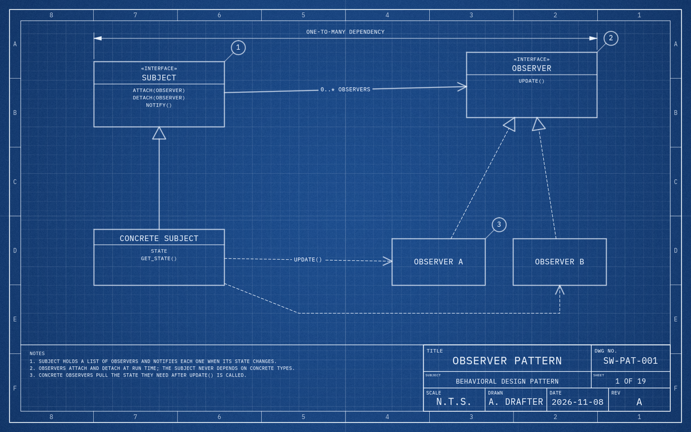

# Blueprint

Software patterns and architectures, drawn as old blueprints. Each sheet is
inked in stroke by stroke on cyanotype paper, with a drafting frame, numbered
notes and a title block, then held and faded for the next one. It is a desktop
viewer and the Omarchy screensaver.



## Sheets

Sixty-five diagrams ship in the binary, including all 23 Gang of Four patterns: from Observer, MVC, Layered, Hexagonal,
Microservices, Event Sourcing, CQRS, Publish/Subscribe, Pipes and Filters,
Load-Balanced Web Tier, Circuit Breaker, Repository, Saga, Cache-Aside,
Strategy, Factory Method, Decorator, Work Queue and Sidecar to Adapter, Facade,
Proxy, Command, Mediator, Chain of Responsibility, Builder, Composite, State,
Template Method, Dependency Injection, Bulkhead, Retry, Transactional Outbox,
Clean Architecture, Microkernel, Backend for Frontend, Strangler Fig, Blue-Green,
Canary, Service Discovery, Consistent Hashing, Leader Election, MapReduce,
Compiler Pipeline, Network Stack, Sharding, Abstract Factory, Prototype, Singleton,
Bridge, Flyweight, Interpreter, Iterator, Memento, Visitor, Unit of Work,
Specification, Anti-Corruption Layer, Bounded Contexts, Domain Events, Two-Phase
Commit, Idempotent Consumer, Actor Model, Event Loop and Lambda Architecture.
`blueprint list`
prints them.

Add your own by dropping JSON files into `~/.config/blueprint/diagrams/`.
Each file holds one diagram (or `{"diagrams": [...]}`) on a 120 × 64 unit
sheet:

```json
{
  "id": "my-pattern",
  "title": "MY PATTERN",
  "category": "WHAT KIND OF THING IT IS",
  "number": "SW-PAT-100",
  "notes": ["FIRST NOTE.", "SECOND NOTE."],
  "nodes": [
    {"id": "a", "label": "SERVICE", "detail": "ONE LINE\nPER ROW", "x": 10, "y": 20, "w": 24, "h": 12},
    {"id": "db", "label": "STORE", "shape": "cylinder", "x": 70, "y": 20, "w": 18, "h": 14}
  ],
  "edges": [{"from": "a", "to": "db", "label": "WRITES", "style": "dashed", "head": "open"}],
  "dimensions": [{"from": "a", "to": "db", "side": "bottom", "offset": 6, "label": "ONE HOP"}],
  "callouts": [{"node": "a", "n": 1}]
}
```

Shapes: `box` (default), `cylinder`, `circle`, `hexagon`, `queue`, `actor`,
`diamond`, `group` (a dashed frame drawn first). A circle takes `"labelAt": "top"`
for nested rings. A node may carry a
`stereotype` such as `«INTERFACE»` and `"fill": true` to hide lines behind it.
Edge heads: `open`, `triangle`, `none`, `both`; `points` are waypoints for an
orthogonal route. Callout `n` refers to the note with that number.
`blueprint check` validates the bundled and user diagrams and exits 1 on any
problem; a broken file is skipped, never fatal.

## Keys

| Key | Action |
| --- | --- |
| Space, →, N | Next sheet |
| ←, Backspace, B | Previous sheet |
| Enter | Finish inking this sheet |
| P | Pause or resume |
| F | Toggle fullscreen |
| Click | Next sheet (right click: previous) |
| ? | Show or hide the keys |
| Ctrl + I | About Blueprint |
| Q, Esc | Quit |

## Screensaver

`blueprint --screensaver --app-id org.omarchy.screensaver` runs fullscreen
with the cursor hidden; any key, click, scroll or pointer movement quits, and
quitting one copy quits the copies on the other monitors. With the app id
above, Hyprland's screensaver rules and the Omarchy idle service treat it like
the stock terminal screensaver.

In Fathom, `./install.sh --screensaver` builds it and makes it the
screensaver Omarchy's idle service starts (see Fathom's README, Screensaver):

```sh
fathom-look screensaver shows blueprint   # or omarchy, fathom, picture, text
fathom-look screensaver preview           # show it now
```

Timing: `--draw 7 --hold 14 --fade 1.2` (seconds) are the defaults.
`--only <id>` repeats one sheet, `--start <id>` opens with one, and `--drawn
<name>` fills the DRAWN cell of the title block (default: your login).

## Commands

```sh
blueprint list [--json]                 # the catalog
blueprint check [files...] [--json]     # validate diagrams, exit 1 on problems
blueprint render out.png --sheet cqrs --at 0.6 --size 1920x1200 --drawn "A. DRAFTER"
```

The commands need no display.

## Build

```sh
bin/build      # qmake6 + make into build/blueprint
bin/test       # builds and runs the Qt Test suite offscreen
```

Fathom's `./install.sh --screensaver` builds it the same way and installs
the binary at `~/.local/share/fathom/blueprint/blueprint`.

Depends on qt6-base, qt6-declarative and qt6-wayland, all part of Omarchy.
MIT licensed; theme and translator plumbing follow Omacut and Monologue.
